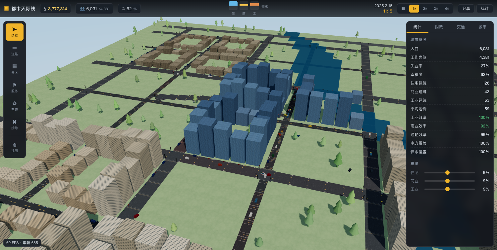

# 都市天际线 · 浏览器版

> 一个仿《都市天际线 2》(Cities: Skylines 2) 的 3D 城市建设模拟游戏，纯网页运行，服务端权威模拟 + SQLite 持久化。

  



> 上图：「天际示范城」——跨河高架大桥 + 弧形道路 + 公交专用道 + 路口红绿灯一应俱全。
> 地址栏 `?c=demo_skyline` 可直接打开；道路上的车辆为实时微观车流仿真的结果。

### ▶ 现在就能玩（本机实例）

| | 地址 |
| --- | --- |
| 局域网 | `http://192.168.137.34:5180` |
| 公网（Cloudflare 隧道） | `https://remote-voting-imposed-factors.trycloudflare.com` |
| 示范城 | 上面任意地址后加 `?c=demo_skyline` |

> 端口是 5180 而不是默认的 5173 —— 5173 被同机器上另一个项目（vite preview）占用了，
> 用 `PORT=5180 npm start` 即可换端口（隧道同理：`cloudflared tunnel --url http://127.0.0.1:5180`）。

---

## 快速开始

```bash
npm install      # 安装依赖 (three / ws / better-sqlite3 / esbuild)
npm start        # 构建前端并启动服务
# 浏览器打开 http://localhost:5173
npm test         # 全链路自检（路网/交通/人口/经济/持久化 + 车队守恒专项）
```

* 无需账号、无需外部资源，地图/城市全部存放在本地 `data/city.db`。
* 默认端口 `5173`，可用 `PORT=8080 npm start` 修改；数据库路径用 `CITY_DB=/path/to.db` 指定。
* 打开页面会自动新建一座城市；把地址栏的 `?c=<城市ID>` 链接发给朋友即可分享同一座城市。

---

## 操作方式（对齐 CS2 习惯）

| 操作 | 按键 / 鼠标 |
| --- | --- |
| 绘制道路 | 选中「道路」后 **左键拖拽**（默认吸附成水平/垂直直线；按住 **Shift** 画斜线；开曲率画弧线；可开高架做立交） |
| 划分区域 | 选中「分区」后左键拖拽涂抹住宅 / 商业 / 工业 |
| 放置设施 | 选中「服务」后左键点击（带覆盖半径预览） |
| **建造高速出入口** | 选中「**出入口**」后左键点击 **地图边缘的道路**（城市与外界的高速匝道） |
| 编辑车道 | 选中「车道」后左键点击路面上的某条车道（循环切换车道类型） |
| 拆除 | 选中「拆除」后左键拖拽 |
| **3D 转视角** | **左键拖拽**（选择模式下，绕目标点旋转，可以任意俯仰/环绕） |
| 平移视角 | 右键拖拽 / 中键拖拽 / Alt+左键拖拽 / WASD / 方向键 |
| 缩放 | 鼠标滚轮 |
| 水平旋转 | Q / E |
| 暂停·继续 | 空格 |
| 速度档位 | 1–5（暂停 / 1× / 2× / 3× / 4×） |
| 工具快捷键 | R 道路、Z 分区、S 服务、**G 出入口**、**L 车道**、X 拆除、V 数据视图、Esc 选择 |

选中「视图」可切换 **分区 / 地价 / 电力·供水 / 交通拥堵** 四种叠加图层；道路颜色会随拥堵由灰变红。

> **WASD** 按住 W 是把视角**推向画面深处**（与镜头朝向一致），A / D 左右平移；
> **左键拖拽 = 真正的 3D 环绕视角**（可以绕着城市转、压低或抬高镜头），右键/中键拖拽 = 平移。
> 俯仰范围 5°–87°，可以从贴地视角一路拉到接近俯视的鸟瞰。

> 视角操作细节：
> * **左键拖拽 = 3D 环绕旋转**（上下拖动 = 抬高/压低俯视角，方向与常见 3D 游戏一致：
>   向下拖 → 看得更俯，向上拖 → 看得更平）；
> * 右键 / 中键 / Alt+左键 = 平移；滚轮 = 缩放；WASD/方向键 = 移动；Q/E = 旋转。

### 电力与供水（简化玩法）

* 电力与供水由 **发电厂（覆盖 900 m）** 与 **水塔（覆盖 620 m）** **按半径自动覆盖**，**不需要铺设水管或电线**——放好设施，周围整片区域自动通电通水。
* 但**必须先有这两样设施**，否则地块不会长出房子（与 CS2 的逻辑一致）。
* 规划分区时会实时提示哪些地块暂时长不出来：`已规划 住宅 38 格　⚠ 12 格缺少电力/供水，这些地块暂时不会发展（城市里还没有发电厂）`。
* 规划预览里，**缺电 / 缺水 / 不临路**的地块会显示为红色，正常地块显示分区本色。
* 发电厂与水塔可以直接放在**已规划的地块**上（会自动清除该格分区），不会出现"先把地全划了就没地方建电厂"的困境。

### 新手引导 · 一键建城 · 高速出入口

**左下角的「🎓 新手引导」面板**（顶栏「说明」按钮可随时重开游戏说明）会按 7 步带你建城，
每一步都会**自动检测是否完成**（做完就自动打勾）：

1. 修一条主路（≥ 12 格）
2. 在地图边缘建「高速出入口」
3. 划一块住宅区（≥ 6 格）
4. 划商业区与工业区（各 ≥ 3 格）
5. 建发电厂 + 水塔
6. 让城市跑起来：人口 > 50 且路上有 8 辆车
7. 试一次税率调节

面板上的 **「⚡ 一键建初级小城」** 按钮会直接生成一座能跑起来的小城：

```
西边缘高速公路 → 东西/南北大道 → 4 个街区 → 住宅/商业/工业分区
                → 发电厂 + 水塔 + 诊所 → 高速出入口
```

建完会自动快进 3 个游戏小时（房子长出来、第一批车开上路），并把速度设为 2×，
所以点完按钮立刻就能看到车流，不用干等。

**高速出入口（对外连接）**：只能建在**地图最外圈的道路**上（费用 800 §），
建好后：

* 一部分出行变成「**外来通勤**」：车从城外的匝道开进来 → 去岗位上班 → 停一会儿 → 再开回匝道驶离城市（占出行总量的 30%）；
* 住宅需求额外提升（城市对外来人口更有吸引力），人口增长更快；
* 地图边缘会出现绿色的 **⇥ 出入口标志牌**。

> 没有出入口的城市只能靠「本地人口自然繁衍」，人口涨得很慢 —— 这就是为什么新手引导
> 特意把「建出入口」列成第 2 步。

### 人口账本：人口不会凭空出现或消失

```
人口来源                     人口出口
├─ 🚗 外来移民（车从高速出入口开进来）   ├─ 💀 死亡
└─ 👶 新生儿（受学校/教育水平影响）      └─ 🚗 迁出（车开出城）
```

* **没有高速出入口 = 没有人来**：城市人口不会凭空增长（这是设计，不是 bug）。
* 移民到来的顺序是：车从匝道开进来 → 开到新家 → 车上的人住下（人口 +1~4）。
* 住房不够时，移民会**排队等安置**（民生面板显示「待安置」人数）—— 这是提示你该盖房了。
* 幸福度低（堵车、缺服务）会同时**抑制移民**并**加快迁出**，人口因此真的会掉。

### 车队守恒：车不会凭空出现 / 消失

```
车队总数 = 路上的车 + 停在车位里的车 + 特种车辆
```

* **车的诞生只有三个理由**：① 居民家庭购车（人口涨了才买车）② 移民开车进城 ③ 特种建筑配车。
* **车的消失只有两个理由**：① 驶出城市（迁出）② 老车报废。
* 车开到目的地后**停进建筑（= 停进车库）**，不再出现在路上，但仍然属于这座城市 ——
  所以你在路面上看到的车辆数量会变，但「城市拥有的车」不会莫名其妙少掉。
* 特种车辆**随特种建筑一起诞生**：建消防站 → 2 辆消防车；拆消防站 → 消防车一起消失。

### 事件系统：火灾 / 犯罪 / 疾病 / 事故 / 学校

事件**不是随机扣血**，而是必须由城市自己去处理：

| 事件 | 需要谁 | 不处理的后果 | 画面表现 |
| --- | --- | --- | --- |
| 🔥 火灾 | 消防车（消防站） | 建筑被烧毁、居民死亡、幸福度下降 | 火焰 + 浓烟 |
| 🚓 犯罪 | 警车（警察局） | 罚款（按城市规模放大）、幸福度下降 | 黄色菱形标记 |
| 🚑 疾病 | 救护车（诊所） | 病人死亡、幸福度下降 | 绿色菱形标记 |
| ⚠ 事故 | 警车（警察局） | **占用车道 → 真的把车流堵住** | 路面闪烁警示条 |
| 🏫 学校 | 校车（学校） | 教育水平低 → 出生率低 | 上下学时间校车出行 |

* 事件发生的频率与城市规模相关，小城市不会一天烧 8 栋房子。
* **没有对应特种建筑 = 事件没人管**，这是玩家扩张服务设施的动力。
* 特种设施在 3D 里拥有**专属外形 + 头顶指示灯 + 光柱**，远远就能认出来。

### 地形 · 桥梁 · 隧道 · 坡度（自然规律）

地图不再是一张平面：**有山、有河、有高有低**，道路必须适应地形。

| 规则 | 表现 |
| --- | --- |
| **坡度上限 15%** | 相邻路段高差超过 2.4 m/格就**修不了路**（提示「坡度超过 15%，请绕山而行，或改修隧道」） |
| **水面自动成桥** | 跨水修路自动架桥：桥面离水面有净空、下面有桥墩，路面与岸边用缓坡接驳 |
| **桥上不能有路口** | 跨水路段只能直行通过，再接一条支路会被拒绝（提示「桥上不能有路口」） |
| **隧道** | 道路选项里切到「隧道」，可以从山体内部穿过（路面在地面以下，两端用坡道接回地面） |
| **高架** | 切到「高架」自动生成坡道，可以与其他道路立体交叉（立交） |
| **不规整地块** | 斜向道路斜切过的地块只能盖**小楼/歪楼**，拐角地块同理 |

路网也遵守坡度：路面高程随地形起伏，坡道与坡度都会**降低车速**，
于是「绕山而行」会付出时间代价，「挖隧道穿山」反而更快 —— 和真实城市一样。

### 实时市政财政（随时在动的钱）

* 所有收支都按**每游戏小时**实时计算：每一格道路、每一座设施每时每刻都在扣维护费，税收也随时在收。
* 财政页显示 **税收 / 道路维护 / 设施维护 / 市政开支 / 净收支（§每时、§每分）**。
* **结算步长**可调（1 / 5 / 10 / 30 / 60 游戏分钟）：每一步就把累计收支写进财政流水。
* 民生页实时显示**人口增减速率**（移民 / 新生儿 / 死亡 / 迁出，每小时多少人）。

### 车速与限速（真实的速度感）

* 不同等级道路限速不同：街道 40 km/h、大道 60 km/h、高速 100 km/h。
* **路口转弯减速**：拐弯时按转弯限速通过路口；**弯道减速**：弧形路段自动降速。
* **坡度减速**：上坡速度下降，行程时间变长 —— 工厂迟到、货物晚到，效率随之下降。
* 1× 速度下车速就是城市里的正常速度（屏幕约 60 km/h），不再是「1× 就飞起来」。

---

## 系统设计

## 车辆仿真实验室（分阶段演示）

`http://<host>:5173/lab.html` 打开**车辆仿真实验室**。它不是录像，而是**真的在跑游戏同一套微观车流物理**，
把复杂的车流逻辑拆成 6 个可以单独观察的阶段：

| 阶段 | 演示内容 | 观察点 |
| --- | --- | --- |
| 1 | **单车**：启动 → 巡航 → 减速 → 停入车位 | 车速曲线：起步加速 → 巡航 → 刹车进位 |
| 2 | **多车**：跟驰与排队 | 与前车距离 ≈ s0 + v·T；队尾自动排成队列 |
| 3 | **红绿灯**：红灯停车排队、绿灯放行 | 信号灯状态 / 排队车辆数随相位变化 |
| 4 | **变道**：前方慢车，后车换道超车 | 「车道」列 0 → 1 就是一次变道 |
| 5 | **拥堵**：瓶颈路段排队回溯 | 排队车辆数持续上升、平均车速持续下降 |
| 6 | **选路**：两条并行路线，按实时拥堵自动选更快的那条 | 本次路线 vs 两条路线拥堵度 |

面板实时显示：每辆车的**状态 / 车速 / 车道 / 与前车距离 / 等待时长**，以及路网拥堵度、排队车辆数、信号灯相位。

---

### 1. 道路核心系统

* 地图为 **48×48 格**（每格 16 m，城区 768 m × 768 m），中间有一条河流，水面修路自动按 3 倍造价建桥。
* 三种道路：**街道**（120 §，2 车道，40 km/h）、**大道**（300 §，4 车道，60 km/h）、**高速公路**（800 §，4 车道，100 km/h）。在已有道路上再次使用道路工具即**升级**，只补差价。
* 瓦片先依据相邻关系生成连接掩码（mask），再抽取为**有向路段 (arc)** 与**交叉口 (node)**：直行段被合并成一条长路段，弯道并入折线，从而得到真实的路网拓扑（而不是逐格跳变的格子路）。
* 交叉口拥有通行容量，容量不足时车辆在路口前排队并**回溯溢出 (spillback)** 到上游路段——这是拥堵能够真实传导的关键。
* 路网连通性会被实时检测，若被拆成多块会在交通面板给出警告（很多新手会把路修断，导致车辆无法到达）。
* 路网是**双层**的：地面层与高架层各自成图，详见 [6. 道路进阶系统](#6-道路进阶系统弧度--坡度立交--车道类型--红绿灯)。

### 2. 交通仿真（真实堵车）

服务端跑的是**微观车流仿真**，不是简单的容量系数：

* **IDM (Intelligent Driver Model)** 跟驰模型：`a = a_max·(1 − (v/v0)⁴ − (s*/s)²)`，含静止间距、车头时距、急动/舒适减速。
* **车身是实体**：每辆车有真实的车长 / 车宽（小汽车 4.2×1.9 m，货车 8.5×2.4 m…），同车道内**车身永不重叠**（保险杠最小间距 0.6 m）。
  发车时也要先在路段上找一段**没有车辆的空隙**，找不到就换起点重试 —— 所以永远不会出现"两辆车叠在一起凭空出现"。
* **路口冲突检测**：垂直方向的车流不能同时占用同一个路口（先到先过，另一方向必须等），
  这正是排队回溯（spillback）能够一路传导到上游街区的原因。
* **物理步长 0.25 游戏秒**，配合客户端插值，车流既有细腻的排队也有顺滑的运动。
* **多车道 + 换道**：车辆按车道独立排队，MOBIL-lite 规则判断是否换到更快车道。
* **交叉口通行权**：车辆必须先取得路口通行权并确认入口有间距才能进入下一段，否则停在路口前排队。
* **路径规划**：Dijkstra（带二叉堆），边权为**当前拥堵度下的实际通行时间**，因此车辆会自发绕开堵点。
* **出行生成**：按居住人口 / 岗位数 × 昼夜分布曲线生成出行需求（小汽车 / 货车 / 自行车），并按秒**均匀释放**（不会整点涌入、也不会只在早高峰有车）。
* 路边还会生成**停放车辆**，视觉上更接近真实街区。

#### 双时钟：交通时钟与经济时钟解耦（这是「车看起来在动」的关键）

早期版本里交通物理直接跟着经济时钟跑（1× 速度 = 每真实秒推进 120 个游戏秒），
结果一辆 11 m/s 的车**每真实秒要跑 1320 米** —— 屏幕上就是「瞬移 / 颜色在跳」，
根本没法观察车辆运动，更谈不上研究排队和拥堵。

现在分成两个时钟：

| 时钟 | 1× 速度 | 用途 |
| --- | --- | --- |
| 城市（经济）时钟 | 2 游戏分钟 / 真实秒 | 人口、税收、地价、昼夜节律 |
| 交通时钟 | 4 交通秒 / 真实秒 | 车辆物理、信号灯、排队、拥堵 |

* 1× 下车辆实际观感速度约 **31 m/s（屏幕 ~0.7 米/帧 @60fps）** —— 连续、可读。
* 交通日 = 24 交通小时 = 3600 交通秒 ≈ 15 真实分钟，早晚高峰用交通小时权重驱动。
* 出行需求设有**路网通行能力上限**（约每 25 km 车道 1 辆/秒）：人口再多也不会把全城堵死，
  超出部分记在 `demandOverflow` 里，UI 上能看到「需求溢出」。

#### 高帧率渲染（30Hz 关键帧 + 60fps 插值 + 航位推算）

渲染思路分三层，目标是**任何时候都有 30 fps 以上的连续运动**：

1. **服务端 30 Hz 广播**关键帧（`BROADCAST_HZ = 30`），每辆车 7 个 float：
   `[x, z, y, heading, typeId, id, speed]`，其中 speed 是交通秒下的 m/s。
2. **客户端插值**：维护一个帧缓冲，在「当前时间 − 45 ms」处按**车辆 ID** 做线性插值
   （位置 + 最短弧朝向）。用 ID 而不是数组下标匹配，车辆生成/消失时不会「颜色乱跳」。
3. **航位推算（dead reckoning）**：若目标时刻已经越过最新关键帧（例如网络抖动掉了一帧），
   用该车的速度沿当前朝向外推（最多约 60 ms），车不会「卡住 → 突然跳一下」。

另外还有**自适应画质**：实测帧率低于 28 fps 时自动降档（像素比 → 阴影 → 分辨率），
高于 56 fps 时再升回去（有滞后锁，避免来回抖动）。左下角会显示
`FPS · 车辆数（行驶数）· 画质`，方便随时确认。

> 两个曾经把画面「黑屏」的坑：
> ① 车辆渲染里 `base.clone()`（数字没有 clone）抛异常 → 每一帧渲染都中断 → 整屏黑；
> ② 主循环没有容错，一处异常就整页卡死。现在主循环包了 try/catch 并只打印前 3 次错误。

### 2.0 人口与资金：随时在算的数

* **入住率模型**：建筑建好不等于立刻满员。每个住宅 / 商业 / 工业地块都有 0–1 的**实时入住率**，
  按需求、幸福度、效率与**昼夜节律**（白天生意旺、客流大）持续趋近目标值。
  于是 `人口 = 建筑容量 × 效率 × 入住率` 是一个**每分钟都在变**的连续数值，
  居民会随需求不足而搬出、商业会因客流下降而裁员。
* **资金按分钟结算**：税收与维护费不再"每月结一次账"，而是**每分钟持续累计**，
  面板上的钱随时都在动；月度结算只负责把这一月的累计值写进财政流水。

> 顺带修掉了一个致命 bug：`advance()` 之前会把不足 1 分钟的小数直接丢弃，
> 导致 1×/2×/3× 速度下**游戏时钟根本不前进**（人口、资金、发展全部静止）。
> 现在小数分钟会被累积，世界在任何速度下都在走。

### 2.1 出行链：市民、货车与公务车辆各有各的行程

每辆车都带一份**多段行程表 `stops[]`**（站点含目的与停留时长），车辆沿路网逐站前进，到站停靠、停留、再开往下一站：

| 车辆 | 行程 | 停留 |
| --- | --- | --- |
| 市民（小汽车 / 自行车） | **家 → 上班 →（55 % 概率）购物 → 家** | 上班 420–900 s，购物 90–300 s |
| 货车 | **工业区 → 商业区送货 → 回仓库** | 送货 60–180 s |
| 特种车辆 | **服务设施 → 事件现场 → 返程** | 现场处置 150–600 s |

* 目的地用**重力模型**挑选：吸引力（岗位 / 人口 / 商业容量）÷ 出行阻抗（距离²），并避开与起点同一个路口（同一路口无可行驶路径）。
* 市民在商业区消费后回家，工业区的货物送到商业区销售 —— 城市的产销闭环就体现在这些行程里。
* 停靠中的车辆会**移出车道**（不算作交通阻塞），但依然计入「在途 / 停靠」统计。
* 交通面板实时显示**出行目的分布**（上班 / 购物 / 货运 / 公务）与**特种车辆出动**次数。

### 2.2 特种车辆按需出动

服务设施不只是提供覆盖，它们还会**按需求派车出勤**（每 25 游戏秒检查一次）：

| 设施 | 派车 | 触发条件 | 现场停留 |
| --- | --- | --- | --- |
| 警察局 | 警车 | 覆盖范围内随机事件点 | 180–420 s |
| 消防站 | 消防车 | 同上 | 240–600 s |
| 诊所 | 救护车 | 同上 | 150–360 s |
| 学校 | 校车 | 同上 | 300–600 s |
| 公园 | 垃圾车 | 同上 | 60–150 s |
| 发电厂 | 货运车（物资） | 同上 | 60–150 s |
| 水塔 | 灵车（殡仪） | 同上 | 120–300 s |

出动概率随人口上升但有上限，同时每类车辆有并发上限（最多 1–3 辆），不会出现警车泛滥。

### 2.3 拥堵 → 效率 → 商业倒闭 → 人口与税收

这是整个游戏的经济主循环，**堵车会真实地让城市亏钱**：

1. **拥堵度**：每个路段按「车流密度 + 速度损失」计算 0–1 的拥堵度，广播给客户端染色（灰 → 红）。
2. **分区效率**：每个地块按**门前路段的拥堵度**折损效率 —— 工业最敏感（`IND_LOSS 0.85`）、商业次之（`COM_LOSS 0.70`）、住宅最轻（`RES_LOSS 0.45`）；断电断水再打 5.5 折。
3. **人口与岗位**：`人口 = 建筑容量 × 效率`，所以堵车会**直接削减人口与岗位**（进而削减税收）。
4. **商业倒闭**：效率低于 `CLOSE_THRESHOLD 0.32` 的商业地块会按小时概率**倒闭降级**（等级 -1，直到关门）。
5. **幸福度**：通勤压力（住宅效率）直接拉低幸福度，幸福度又影响需求与人口。
6. **闭环**：工业效率下降 → 工厂无法按时开工、产能下降 → 岗位减少 → 居民失业 → 住宅需求下降 → 人口流失 → 税收下滑。

统计面板会实时显示 **工业效率 / 商业效率 / 通勤效率** 三个百分比（< 85 % 橙色，< 60 % 红色）。

### 3. 人口与发展系统

* 住宅 / 商业 / 工业三种分区，每格建筑 3 个等级，容量分别不同（住宅 8→26→74 人，商业 6→22→62 岗，工业 16→44→96 岗）。
* 建筑需要**临路 + 电力 + 供水**才会在空地上生长；等级提升取决于土地价值（0–100）。
* **RCI 需求条**：住宅看岗位供给与失业率、商业看商业岗位占人口比例、工业看生产与物流需求，三者互相牵制形成经典的需求平衡。
* 幸福度由服务覆盖、税率、失业率、拥堵与地价共同决定。
* **土地价值**由临路距离、服务覆盖、公园、污染（工业扩散场）、噪声（道路拥堵）与滨水加成计算，并做空间扩散平滑。

### 4. 经济系统

* 税收：住宅 / 商业 / 工业税率可 0–20% 独立调节，税基分别为每人 26 §、每商业岗 42 §、每工业岗 34 §（满税率）。
* 支出：道路维护（街道 4 / 大道 9 / 高速 20 § 每格每月）+ 设施维护 + 市政管理费 320 §。
* 月度结算生成**财政流水**，写入 SQLite `ledger` 表，面板可查历史结余。
* 资金不足时幸福度下降、发展停滞（不会强制破产，可继续调整税率救市）。

### 5. 服务设施

| 设施 | 造价 | 月维护 | 覆盖半径 | 容量 |
| --- | --- | --- | --- | --- |
| 警察局 | 2500 | 220 | 320 m | 4000 人 |
| 消防站 | 2500 | 220 | 320 m | 4000 人 |
| 诊所 | 3200 | 300 | 300 m | 3500 人 |
| 学校 | 4000 | 380 | 420 m | 5200 人 |
| 公园 | 400 | 25 | 170 m | — |
| 发电厂 | 12000 | 900 | 900 m | — |
| 水塔 | 1200 | 90 | 620 m | — |

服务覆盖会随服务人口超出容量而**按比例衰减**，这与 CS2 的「服务不足」表现一致。

### 6. 道路进阶系统：弧度 · 坡度立交 · 车道类型 · 红绿灯

这是本项目在「道路核心系统」之上做的四组扩展，也是 CS2 里最有辨识度的部分。

#### 6.1 弧度道路（8 方向 + 贝塞尔曲线）

* 路网不是正交网格，而是 **8 方向连接掩码**：除南北东西外还支持 45° 斜向连接。
* **画路默认「吸附成直线」**：拖拽时终点会被拉回起点所在的行或列，
  所以手抖也画不出歪歪扭扭的斜路；想画斜线就 **按住 Shift（或 Alt）** 自由拖拽，
  服务端的路网掩码、客户端的路面网格都支持 45° 斜向连接，斜路与正交路可以正常汇入。
* 「道路」工具面板有 **曲率滑块（0–100 %）**：拖动后画线会按二次贝塞尔曲线生成弧形路段，路径再经**拉绳简化 (string-pulling)** 拉直，但**保留起点与终点**，因此弧线一定能和已有路网对接。
* 弧形路段的折线顶点带**真实朝向**，车辆沿着弧线行驶时会自然转向；弯道处会生成独立路口节点（便于排队与转向）。
* 斜向连接只有在两个共同正交邻居**同时**是道路时才被拒绝（避免斜路在十字口与正交路打架），其余情况斜路都能正常汇入主干道。

#### 6.2 坡度与立体交叉（双层路网）

* 每个地块同时存在 **地面层 `road`** 与 **高架层 `over`** 两套路网，互不干扰 —— 这就是真正的**立交**（同一条路既能从桥下过，也能从桥上走）。
* 勾选「高架道路」后自动生成**坡道剖面**：两端各 6 格爬升到 9 m 桥面，中段为平桥，最大坡度 9.4 %（上限 18 %），相邻格高差 ≤ 2 m。
* **高程兼容判定**：同层路段高差 ≤ 2 m 才连通；跨层仅在坡道落地处（高程 ≈ 0）连通。所以桥上桥下**互不串行**，这正是立交桥的物理特性。
* 渲染上会生成**桥面、桥墩、路缘**，坡道随高程平滑过渡；地面路可以在桥下自由穿过（互不冲突）。
* 交通仿真里坡度会真实影响车速：上坡按 `ELEV.GRADE_SPEED_PENALTY` 减速，下坡略加速。

#### 6.2.5 车道几何：服务端与渲染端必须完全一致

车辆的横向位置由「道路总车道数 N、单车道宽 `width/N`、全局车道号 g」唯一决定：

```
横向偏移 = side × (g − (N−1)/2) × (width / N)      // side = 该方向占道路的哪一侧
```

* 服务端（`traffic.js _placeOnLane`）与渲染端（`roads.js _rebuildLaneBands`）用**同一套公式**，
  所以车轮一定压在自己的车道线上，不会骑到隔壁车道或压马路牙子。
* 道路宽度必须 ≤ 建筑退线（否则房子会压在马路上）：街道 8 m（1 车道/方向）、
  大道 11 m（2 车道/方向）、高速 16 m（2 车道/方向）。
* 路面贴图的 UV：**u = 横向、v = 沿路方向**。早期版本东西向道路把 u/v 弄反了，
  车道线贴图被转了 90°（虚线横跨马路），现已修正。
* 十字路口上同时存在东西向与南北向道路时，车道色带会**按每个存在的方向各画一遍**，
  不会再出现「只有一个方向有线」的情况。
* **穿模防护**：IDM 是软约束，急刹时可能刹不住，所以在推算位移后再做一次硬钳制
  —— 同车道内不允许车身越过前车（最小间隙 0.4 m），保证任何时候都不会出现两车重叠。
* 停靠中的车（进站 / 上班）不再画在车道中央，而是画到马路牙子外侧的路肩，
  避免和后车重叠；路边装饰停车统一放在街道的另一侧路肩，两者互不重叠。

#### 6.3 车道类型（4 类）

用「车道」工具（快捷键 **L**）点击路面上的某条车道即可**循环切换**类型，路面上会实时显示对应颜色的色带：

| 车道类型 | 颜色 | 可通行车辆 | 说明 |
| --- | --- | --- | --- |
| 常规车道 | 白 | 小汽车 / 货车 / 公交 | 默认 |
| 公交车道 | 蓝 | 仅公交 | 专用道，其他车辆禁止驶入 |
| 自行车道 | 绿 | 仅自行车 | 自行车通行，机动车禁入 |
| 转弯车道 | 黄 | 小汽车 / 货车 | 右转 / 转向专用 |

* 车道类型按**每车道 2 bit** 打包存储在瓦片上（地面层 `lt`、高架层 `olt` 各自独立），整段路同步生效。
* 车辆在选道时会自动避开不允许自己的车道（公交只会走公交道 / 常规道，自行车只走自行车道），无专用车道可用时回退到常规车道。
* 编辑工具用射线与路面求交，**自动区分地面层与高架层**，点击高架桥上的车道只会改高架那一层。

#### 6.4 红绿灯系统

* **相位模型**：每个信号路口按「南北放行 → 东西放行」两相位循环，绿 22 s / 黄 3 s / 全红 1 s，完整周期 52 s。
* **绿波协调**：各路口的相位沿 x / z 方向按 `SIGNAL.WAVE` 提前偏移，形成沿走廊推进的连续绿带，车辆可一路少停。
* **放行规则**：红灯时车辆在停止线前排队；绿灯还需满足「路口通行权容量」与「入口车道有足够间距」才能驶入，否则继续排队 —— 因此路口会形成真实的**排队回溯 (spillback)**。
* **信号灯只设在真正的交叉口**：3 个以上方向、且**两条主干道相交**时才设灯；主干道 × 支路、支路交叉、死头路、弯道与高速互通一律让行（避免小街区路口过多导致车流处处停等）。
* 3D 场景中每个进口方向都会渲染**信号杆 + 三色灯头**，灯色与仿真相位**逐帧同步**（服务端把信号灯状态贴图随状态帧广播给客户端）。

---

---

## 分享与存档

* **分享链接**：点右上角「分享」复制 `http://<host>/?c=<城市ID>`，对方打开即是同一座城市（服务端权威模拟）。
* **复制城市**：「城市」页 → 复制当前城市，生成一份可自由改造的副本并得到新链接。
* **公开城市列表**：「城市」页可浏览所有存档过的城市并一键跳转。
* **SQLite 结构**：

```
cities(id, name, seed, tick, funds, population, is_public, created_at, updated_at, snapshot)
saves (id, city_id, label, created_at, snapshot)     -- 手动存档（gzip JSON）
ledger(id, city_id, tick, income, expense, net, funds, population, created_at)
events(id, city_id, tick, kind, text, created_at)    -- 操作日志
```

* 城市快照为 gzip 压缩的 JSON，进程重启后自动恢复并继续模拟。

### 局域网 / 局域网外访问

`server/index.js` 默认监听 `0.0.0.0:5173`，因此同一局域网内的其它设备可以直接访问：

```bash
# 查看本机内网 IP
ipconfig getifaddr en0     # macOS
# 其它设备打开
http://<内网IP>:5173
```

若需要公网访问，把 `5173` 端口在路由器上映射到本机即可（并确保 macOS 防火墙放行）。

> ⚠️ 对外开放前请注意：**公开城市列表与分享链接都没有鉴权**，任何拿到地址的人都能创建 / 打开城市。

**没有公网 IP 时的临时方案（Cloudflare 快速隧道）**

```bash
# 下载 cloudflared（macOS）
curl -L -o cloudflared.tgz https://github.com/cloudflare/cloudflared/releases/latest/download/cloudflared-darwin-arm64.tgz
tar xzf cloudflared.tgz && chmod +x cloudflared

# 建立隧道，会打印一个 https://xxx.trycloudflare.com 网址
./cloudflared tunnel --url http://127.0.0.1:5173
```

把打印出来的网址加上 `?c=demo_skyline` 就能从公网直接打开示范城（WebSocket 走同一条隧道，已验证可用）。
注意：免账号的 quick tunnel **每次重启都会换网址**，且没有可用性保证。

### 部署到云服务器 / 容器平台

项目本身就是一个标准 Node 服务：**端口用 `PORT`、数据库路径用 `CITY_DB`** 环境变量控制，
仓库里已经带好 `Dockerfile` 与 `docker-compose.yml`：

```bash
docker compose up -d          # 起服务，数据落在具名卷 city-data
# 或者
docker build -t city .
docker run -d -p 5173:5173 -v $PWD/data:/app/data city
```

可直接部署、且支持 **WebSocket + 持久化磁盘**（SQLite 需要磁盘）的平台：

| 平台 | 做法 | 注意 |
| --- | --- | --- |
| Railway / Fly.io | 仓库直连，检测 `Procfile` / `Dockerfile` | 挂一个卷给 `/data`，否则重启丢存档 |
| 阿里云 / 腾讯云轻量应用服务器 | 装 Docker 后同 `docker compose` | 最省心，固定公网 IP + 域名 |
| 自己的机器 | `npm start` + cloudflared 隧道 | 隧道每次重启换域名 |

健康检查可直接打 `GET /api/cities`（返回 JSON 数组）。

---

## 示范城生成脚本

`scripts/make-demo.mjs` 会从零规划一座布局合理的示范城市并快进模拟：

```bash
node scripts/make-demo.mjs 45     # 生成 45 个游戏日并写入 SQLite（demo_skyline）
```

它会铺设大道 / 街道 / 外环高速 + 一段**高架立交**，按临街地块划分住宅 / 商业 / 工业区，
建造发电厂 / 水塔 / 警察局 / 消防站 / 诊所 / 学校 / 公园，然后模拟若干游戏日让城市长起来。


---

## 目录结构

```
server/
  index.js            HTTP + WebSocket 服务、REST API
  game.js             权威模拟循环、状态广播（自定义二进制帧）、指令处理
  db.js               SQLite 持久层（better-sqlite3, WAL）
  sim/
    constants.js      全部数值参数（道路/分区/服务/经济/需求/交通/土地价值）
    city.js           城市主体：地块状态、时钟、玩家指令
    roadnet.js        瓦片 → 交叉口 + 有向路段的路网抽取
    traffic.js        IDM 车流、换道、路口排队、路径规划、停放车辆
    develop.js        服务覆盖、土地价值、发展成长、RCI 需求、预算结算
public/
  index.html          UI 结构
  css/app.css         界面样式
  js/
    main.js           入口装配与主循环
    net.js            WebSocket 客户端 + 客户端状态镜像
    camera.js         RTS 相机（平移/旋转/缩放/键盘）
    tools.js          拖拽绘制、分区涂抹、拆除、设施放置
    ui.js             HUD / 面板 / 提示 / 城市列表
    render/           world 场景 · roads 路面 · buildings 建筑 · agents 车辆
                      props 树木 · signals 信号灯 · overlay 叠加层
scripts/
  make-demo.mjs       示范城生成器（规划路网 + 分区 + 设施 + 快进模拟）
test/
  smoke.mjs           全链路冒烟测试（路网/交通/人口/经济/持久化）
  flow.mjs            出行链 / 特种车辆 / 拥堵经济 专项测试
  lab.mjs             车辆仿真实验室 6 个阶段的自动验收
build.js              esbuild 打包（three → public/build/app.js）
```

---

## 性能与规模说明

* 地图固定 48×48 = 2304 格，车辆上限 1100 辆，以控制服务端运算量。
* 服务端 30 Hz 推进模拟，12 Hz 广播状态；二进制帧结构为 `[4B 头长度][JSON 头][Float32 车辆坐标][Uint8 拥堵贴图][Uint8 信号灯贴图]`，增量只发送变化的地块（每格 15 个字段）。
* 实测：7800 人城市、4× 速度下服务端 CPU ≈ 0.6%，浏览器端稳定 60 FPS。
* 若要更大地图，修改 `server/sim/constants.js` 中的 `MAP.SIZE` 即可（同时需相应调整交通上限与广播频率）。

---

## REST API

| 方法 | 路径 | 说明 |
| --- | --- | --- |
| GET | `/api/config` | 道路/分区/服务/税率等配置 |
| GET | `/api/cities` | 城市列表 |
| POST | `/api/cities` | 新建城市 |
| GET | `/api/cities/:id` | 城市概要 + 财政流水 |
| POST | `/api/cities/:id/clone` | 复制城市（可分享副本） |
| POST | `/api/cities/:id/snapshot` | 导入城市快照 |
| GET | `/api/cities/:id/snapshot` | 导出城市快照 |
| GET | `/api/cities/:id/ledger` | 财政流水 |
| GET | `/api/cities/:id/events` | 操作日志 |
| DELETE | `/api/cities/:id` | 删除城市 |

WebSocket `/ws`：客户端发 `{type:'join', cityId}` 入城，`{type:'command', action:'road'|'zone'|'bulldoze'|'service'|'tax'|'lane'|'speed'|'rename'|'save', ...}` 下指令；服务端推二进制状态帧与 `{type:'msg'}` 提示。

其中 `road` 指令支持 `{tiles, roadType, elevated}`（`elevated=true` 即架设高架），`lane` 指令支持 `{tile, lane, layer}`（`layer` 为 0 地面层 / 1 高架层）。
